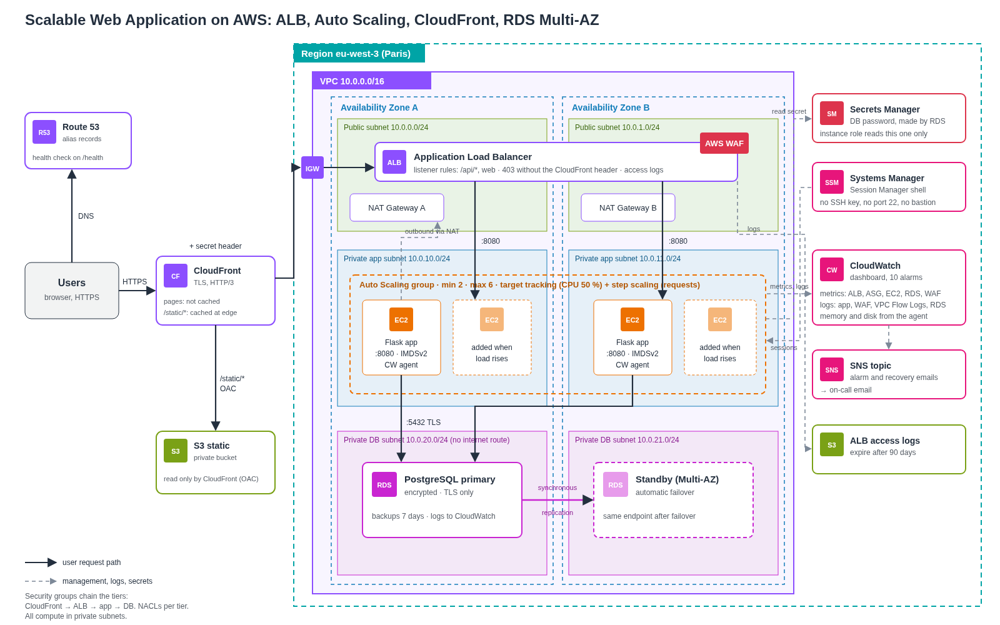

# Scalable Web Application with ALB and Auto Scaling

**AWS Solutions Architect – Associate · Graduation Project 1 · EC2-based architecture**

A production-grade web application on AWS. It runs on EC2 instances in private subnets across two
Availability Zones, behind an Application Load Balancer protected by AWS WAF. CloudFront serves the site and
caches static assets from S3, and a Multi-AZ RDS PostgreSQL database stores the data. Everything is built with
Terraform, monitored with CloudWatch, and reachable for administration only through Systems Manager Session Manager.



*Diagram source: [docs/architecture.svg](docs/architecture.svg) (editable SVG).*

---

## Contents

1. [What it does](#what-it-does)
2. [Services and why each one is used](#services-and-why-each-one-is-used)
3. [Network design](#network-design)
4. [How a request flows](#how-a-request-flows)
5. [Security](#security)
6. [High availability and scaling](#high-availability-and-scaling)
7. [Monitoring and alerting](#monitoring-and-alerting)
8. [Deploy it](#deploy-it)
9. [Test and demonstrate it](#test-and-demonstrate-it)
10. [Cost](#cost)
11. [Design decisions and trade-offs](#design-decisions-and-trade-offs)
12. [Well-Architected Framework mapping](#well-architected-framework-mapping)
13. [Repository structure](#repository-structure)
14. [Clean up](#clean-up)

---

## What it does

The demo application (Flask, [app/app.py](app/app.py)) shows on every page **which EC2 instance and which
Availability Zone answered**, plus a visit counter stored in RDS. Refreshing the page shows the load balancer
spreading traffic. Stopping an instance, failing over the database, or loading the CPU shows the architecture
heal and scale itself.

| Path | Purpose |
| --- | --- |
| `/` | HTML page: instance, AZ, visit counter from PostgreSQL |
| `/health` | Load balancer health check (no database call, on purpose) |
| `/api/info` | Instance and AZ as JSON |
| `/api/db` | Database version and server IP (shows the failover) |
| `/api/load` | Burns about 0.5 s of CPU, to trigger Auto Scaling |
| `/static/*` | CSS and images from S3, cached by CloudFront |

## Services and why each one is used

| Service | Configuration | Why |
| --- | --- | --- |
| **VPC** | 10.0.0.0/16, 2 AZs, 3 tiers of subnets (public, app, db), route table per tier, NACLs per tier, VPC Flow Logs | Isolation: only the load balancer and NAT Gateways have public addresses |
| **NAT Gateway** | One per AZ (or one shared in the lab profile) | Private instances can download packages and reach AWS APIs without being reachable from the internet |
| **EC2 + Launch Template** | Amazon Linux 2023, IMDSv2 only, encrypted gp3, instance profile, user data installs the app | Repeatable, hardened instances |
| **Auto Scaling group** | min 2, max 6, both AZs, ELB health checks, rolling instance refresh | Self-healing and elastic capacity |
| **Scaling policies** | Target tracking on CPU (50 %) + step scaling on requests per instance | Smooth scaling for normal load, fast reaction to bursts |
| **Application Load Balancer** | Public subnets, listener rules (`/api/*`, web), health checks on `/health`, access logs to S3 | Layer-7 routing and spreading load across AZs |
| **AWS WAF** | Web ACL on the ALB: AWS Common Rule Set (OWASP Top 10), Known Bad Inputs (Log4Shell), SQL injection, per-client rate limit | Blocks common web attacks before they reach the app |
| **CloudFront** | TLS, HTTP/2 and HTTP/3, pages not cached, `/static/*` cached from S3, security headers | Lower latency, offloads static files, single public entry point |
| **S3** | Private bucket for static assets (read only by CloudFront via Origin Access Control); bucket for ALB logs | Durable, cheap storage; no public bucket |
| **RDS Multi-AZ** | PostgreSQL 16, synchronous standby in the other AZ, encrypted, TLS required, 7-day backups, password managed in Secrets Manager | Automatic failover without changing the endpoint |
| **Route 53** | Alias records (`app.` → CloudFront, `origin.` → ALB) when a domain is set; HTTPS health check on `/health` always | DNS and an outside-in check of the whole path |
| **Systems Manager** | Session Manager through the instance role | Shell access with no SSH key, no port 22 and no bastion host |
| **CloudWatch + SNS** | Dashboard, 11 alarms, app/WAF/VPC/RDS logs, memory and disk from the CloudWatch agent, email alerts | See problems before users report them |
| **Secrets Manager** | Database password created and stored by RDS | No password in code, Terraform state or user data |

## Network design

| Tier | AZ A | AZ B | Route to the internet | Who can reach it |
| --- | --- | --- | --- | --- |
| Public | 10.0.0.0/24 | 10.0.1.0/24 | Internet Gateway | CloudFront (ALB security group uses the CloudFront prefix list) |
| App (private) | 10.0.10.0/24 | 10.0.11.0/24 | NAT Gateway of the same AZ | The ALB only, on port 8080 |
| Database (private) | 10.0.20.0/24 | 10.0.21.0/24 | **None** | The app instances only, on port 5432 |

Each private app subnet has its own route table pointing at the NAT Gateway in its own AZ, so the loss of one AZ
does not cut the other AZ off the internet. A free S3 gateway endpoint keeps S3 traffic off the NAT Gateway.

**Two layers of filtering:**
- **Security groups** (stateful, per instance) chain the tiers. The ALB accepts the CloudFront ranges, the app
  accepts the ALB, the database accepts the app. Every rule references a security group, not an IP range,
  except the CloudFront prefix list.
- **Network ACLs** (stateless, per subnet) add a second wall. The app subnets accept port 8080 from the public
  subnets only, and the database subnets accept 5432 from the app subnets only.

## How a request flows

1. The user opens `https://app.<domain>` (Route 53 alias) or the CloudFront address.
2. **CloudFront** terminates TLS. `/static/*` is served from the edge cache, or from S3 through Origin Access
   Control. Everything else goes to the ALB with a secret `X-Origin-Verify` header.
3. **AWS WAF** inspects the request on the ALB and blocks injection, known exploits and abusive clients.
4. The **ALB listener rules** forward requests that carry the secret header to the target group (`/api/*` and web
   pages are separate rules). Requests without it get a 403, so nobody can bypass CloudFront and WAF.
5. An **EC2 instance** in a private subnet answers. It reads the database password from Secrets Manager with its
   instance role and queries **RDS** over TLS.

## Security

| Control | Where |
| --- | --- |
| No compute in public subnets; database subnets have no internet route | [network.tf](terraform/network.tf) |
| Security groups chained by reference; the default security group stripped of all rules | [security.tf](terraform/security.tf) |
| ALB reachable only from CloudFront (prefix list + secret header, 403 otherwise) | [security.tf](terraform/security.tf), [alb.tf](terraform/alb.tf) |
| WAF: OWASP Top 10, Log4Shell, SQL injection, rate limit; the secret header is redacted from WAF logs | [waf.tf](terraform/waf.tf) |
| No SSH: Session Manager only, every session logged | [iam.tf](terraform/iam.tf) |
| IMDSv2 required (blocks credential theft through SSRF) | [compute.tf](terraform/compute.tf) |
| Least-privilege instance role: it can read one secret, nothing else | [iam.tf](terraform/iam.tf) |
| Encryption at rest: EBS, RDS, S3; in transit: TLS viewer side, `rds.force_ssl=1` | several files |
| Database password never in code or state (`manage_master_user_password`) | [database.tf](terraform/database.tf) |
| S3 buckets private, public access blocked, TLS-only policy | [storage.tf](terraform/storage.tf) |
| Security headers (HSTS, X-Frame-Options, nosniff) added by CloudFront | [cdn.tf](terraform/cdn.tf) |
| VPC Flow Logs, ALB access logs, WAF logs, RDS logs | several files |

**Static analysis:** [Checkov](https://www.checkov.io/) runs in CI. Result: 271 checks passed, 0 failed.
29 checks are skipped, each with its reason written next to the resource (`#checkov:skip=...:reason`), for
example "ALB log delivery only supports SSE-S3".

## High availability and scaling

| Failure or event | What happens |
| --- | --- |
| An instance crashes or fails `/health` | The ALB stops sending it traffic within about 45 s; the ASG (ELB health checks) replaces it |
| A whole AZ fails | The ALB, the ASG and RDS keep running in the other AZ; the ASG launches replacements there; each AZ has its own NAT Gateway |
| The primary database fails | RDS promotes the synchronous standby, usually in 1–2 minutes; the endpoint name stays the same and the app reconnects |
| CPU rises (normal growth) | **Target tracking** keeps the average CPU near 50 % by adding or removing instances |
| Sudden burst of requests | **Step scaling**: over 1,000 requests per instance per minute adds 1 instance, over 2,000 adds 2 |
| New code or AMI | A new launch template version triggers a **rolling instance refresh** (at least 50 % stays healthy) |

## Monitoring and alerting

- **Dashboard** (`dashboard_url` output): requests and 5xx, p50/p95 latency, healthy instances vs desired
  capacity, CPU of instances and database, WAF allowed vs blocked, database connections and free storage,
  instance memory and disk.
- **Alarms → SNS → email:** ALB 5xx, app 5xx, unhealthy hosts, no healthy host, p95 latency over 1 s,
  database CPU, free storage and connections, WAF blocks, and a Route 53 health check of the whole path
  (CloudFront → WAF → ALB → instance).
- **Logs:** app (CloudWatch agent), WAF, VPC Flow Logs, RDS PostgreSQL and enhanced monitoring, ALB access logs in S3.

## Deploy it

**Requirements:** an AWS account, AWS CLI v2 configured, Terraform ≥ 1.6, and the
[Session Manager plugin](https://docs.aws.amazon.com/systems-manager/latest/userguide/session-manager-working-with-install-plugin.html)
if you want a shell.

```bash
cd terraform
cp terraform.tfvars.example terraform.tfvars   # set alarm_email; the lab profile is cheaper and destroyable
terraform init
terraform plan -out tfplan
terraform apply tfplan                          # about 15-20 minutes (RDS Multi-AZ and CloudFront are the slow parts)
terraform output app_url
```

Confirm the SNS subscription email to receive alarms. Instances need 2–3 minutes after launch to install the
app and pass health checks.

**Custom domain (optional):** set `domain_name` and `hosted_zone_id` (a Route 53 public hosted zone you own).
Terraform then issues two ACM certificates and validates them by DNS: one in us-east-1 for CloudFront, one in
the region for the ALB. It creates `app.<domain>` → CloudFront and `origin.<domain>` → ALB, and switches
CloudFront → ALB to HTTPS.

## Test and demonstrate it

| Script | What it proves |
| --- | --- |
| [scripts/smoke-test.sh](scripts/smoke-test.sh) | Requests spread over instances and AZs, direct ALB access returns 403, static files hit the CloudFront cache, WAF blocks an SQL injection, security headers are present |
| [scripts/load-test.sh](scripts/load-test.sh) | CPU passes 50 %, the ASG scales out, then back in when the load stops |
| [scripts/failover-test.sh](scripts/failover-test.sh) | `--force-failover` on RDS: `/api/db` shows a new server IP behind the same endpoint |
| [scripts/ssm-shell.sh](scripts/ssm-shell.sh) | A shell on a private instance with no SSH and no bastion |

**Suggested 5-minute demo video:**
1. Open the app and refresh: the instance and AZ change.
2. `curl` the ALB directly: 403.
3. Run the smoke test: WAF blocks the injection, static files come from the cache.
4. Run the load test and show the dashboard: instances go from 2 to 4.
5. Terminate an instance in the console: the ASG replaces it and the site stays up.
6. Run the failover test: the database server IP changes and the app keeps working.
7. Open a Session Manager shell.

## Cost

Approximate on-demand prices in eu-west-3, in USD per month (730 hours), before free tier. Check them with the
[AWS Pricing Calculator](https://calculator.aws/) before deploying.

| Item | HA profile (default) | Lab profile |
| --- | --- | --- |
| NAT Gateway (hourly part) | 2 × ~35 | 1 × ~35 |
| Application Load Balancer | ~20 | ~20 |
| EC2 2 × t3.micro | ~17 | ~17 |
| RDS db.t4g.micro Multi-AZ + 20 GB gp3 | ~30 | ~30 |
| AWS WAF (Web ACL + 4 rules) | ~9 + requests | ~9 + requests |
| Public IPv4 addresses (NAT, ALB) | ~15 | ~11 |
| CloudWatch, Route 53 health check, Secrets Manager | ~6 | ~6 |
| CloudFront | free tier for low traffic | free tier |
| **Total** | **~165** | **~130** |

That is about 0.20 USD per hour. **Deploy, record the demo, and destroy the same day: a few dollars.**

## Design decisions and trade-offs

- **The WAF is on the ALB, as the brief asks.** Traffic comes through CloudFront, so WAF sees CloudFront's IP
  addresses as the source. Two consequences. The rate limit counts the client IP that CloudFront writes in
  `X-Forwarded-For`, and the AWS IP reputation list (which only checks the source IP) is not used. In
  production I would move the Web ACL to CloudFront (scope `CLOUDFRONT`, us-east-1): it then sees real client
  IPs and blocks attacks at the edge, before they cost anything.
- **Route 53 points users at CloudFront, not at the ALB.** CloudFront in front of the ALB is the right entry
  point. The ALB alias the brief asks for exists as `origin.<domain>`, which CloudFront uses as its HTTPS origin.
- **The ALB only answers CloudFront.** The CloudFront prefix list in the security group plus a secret header in a
  listener rule. The prefix list alone is not enough, because any CloudFront distribution shares those IPs.
- **`/health` does not touch the database.** If it did, a slow database would make every instance look unhealthy,
  and the ASG would replace healthy instances in a loop.
- **One NAT Gateway per AZ by default.** It costs about 35 USD per month more, but a single NAT Gateway is a single
  point of failure for the private subnets' outbound traffic. The lab profile accepts that risk to save money.
- **No bastion host.** Session Manager gives an audited shell without opening any inbound port.
- **No ACM certificate without a domain.** CloudFront's default certificate covers `*.cloudfront.net`, and
  CloudFront → ALB uses HTTP inside AWS in that mode. With a domain, both legs are HTTPS (TLS 1.2+).

## Well-Architected Framework mapping

| Pillar | How this design applies it |
| --- | --- |
| Operational excellence | Everything in Terraform; CI with fmt, validate, tflint and Checkov; rolling instance refresh; dashboard and runbook scripts |
| Security | Private compute, chained security groups, NACLs, WAF, no SSH, IMDSv2, least-privilege role, encryption everywhere, managed secrets, logs |
| Reliability | 2 AZs for every tier, ELB health checks, self-healing ASG, RDS Multi-AZ, NAT Gateway per AZ, Route 53 health check |
| Performance efficiency | CloudFront edge caching and HTTP/3, static files offloaded to S3, target tracking + step scaling, gp3 storage |
| Cost optimization | Right-sized defaults (t3.micro, db.t4g.micro), scale-in to 2, free S3 gateway endpoint, lab profile, log expiry |
| Sustainability | Scale to demand instead of over-provisioning; Graviton (t4g) for the database |

## Repository structure

```
.
├── README.md                      this document
├── docs/architecture.svg|png      solution architecture diagram
├── app/                           Flask application, static assets, requirements
├── terraform/
│   ├── versions.tf                providers (region + us-east-1 for CloudFront certificates and health-check alarm)
│   ├── variables.tf, locals.tf    inputs and derived values
│   ├── network.tf                 VPC, subnets, IGW, NAT, route tables, NACLs, endpoints, Flow Logs
│   ├── security.tf                security groups, origin secret
│   ├── iam.tf                     instance role (SSM, CloudWatch agent, one secret), Flow Logs role
│   ├── storage.tf                 S3 static bucket (OAC) and ALB log bucket
│   ├── database.tf                RDS PostgreSQL Multi-AZ
│   ├── compute.tf                 launch template, Auto Scaling group, scaling policies
│   ├── user_data.sh.tftpl         instance boot script
│   ├── alb.tf, waf.tf, cdn.tf     ALB and listener rules, WAF, CloudFront
│   ├── dns.tf                     ACM, Route 53 records and health check
│   ├── monitoring.tf              SNS, alarms, dashboard
│   └── outputs.tf
├── scripts/                       smoke, load, failover and Session Manager scripts
└── .github/workflows/ci.yml       Terraform checks, tflint, Checkov, shellcheck
```

## Clean up

```bash
cd terraform
terraform destroy
```

With the lab profile, deletion protection is off and no final snapshot is taken, so this removes everything.
With the default profile, first set `db_deletion_protection = false` and `alb_deletion_protection = false`, then
apply and destroy.

---

*Author: Raed Aroua · [github.com/raeeed08](https://github.com/raeeed08)*
